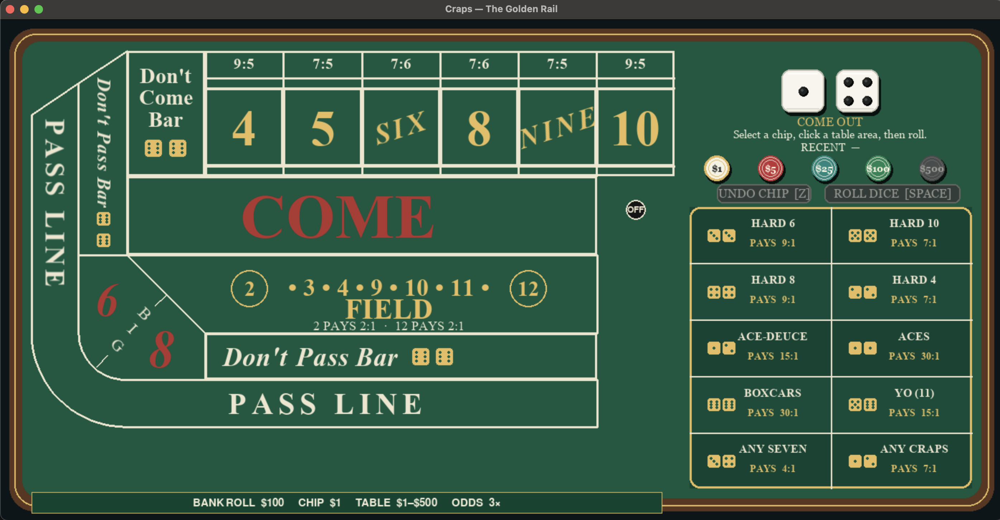

# The Golden Rail — Craps

A playable craps game built with Python and Pygame. The table is the interface: choose a chip, click a printed betting area, and roll. The project combines a rules and bankroll engine with a casino-style, responsive table UI.



## What it does

- Implements Pass Line, Don't Pass, Come, Don't Come, Field, Place 4/5/6/8/9/10, Hard 4/6/8/10, and the printed proposition bets (Any Seven, Ace-Deuce, Aces, Boxcars, Yo, and Any Craps), plus odds on eligible line bets.
- Enforces come-out and point phases, wager limits, exact whole-dollar payout amounts, and bankroll accounting.
- Shows wagers as chip stacks on their corresponding table areas. Click a stack to add to that wager or, when eligible, add odds to that specific bet. Proposition bets resolve on the next roll.
- Provides chip selection, hover feedback, recent-roll status, undo before the next roll, and a roll animation.
- Resizes the table while preserving the layout.

## How it was built

I built the original game engine and core flow through Pass Line and Field bets. I then used AI assistance to help with the casino-style table design and UI, and to finish the remaining bet types, payout and settlement cases, and interaction details. The rules engine remains separate from the Pygame presentation so that wager resolution and bankroll behavior can be tested independently.

## Project structure

- `craps/engine/` — bet types, dice, game phase and roll history, wager validation, payout calculation, and bankroll settlement.
- `craps/ui/board.py` — table artwork and the shared geometry for its betting areas, including the proposition grid.
- `craps/ui/betting.py` — direct hit-testing against that same table geometry, chip accumulation, wager placement helpers, and on-table chip stacks.
- `craps/ui/viewport.py` — letterbox scale and offset transforms shared by resized-window rendering and mouse coordinates.
- `craps/ui/main.py` — Pygame event loop, controls, status display, and dice animation.
- `tests/` — deterministic tests for dice, game flow, bet rules, payouts, and table betting interactions.

## Rules and defaults

The default table starts with a $100 bankroll, a $1 minimum base wager, a $500 maximum base wager, a $500 maximum on any single base wager, and odds up to 3× the associated line wager. The selectable chip denominations are $1, $5, $25, $100, and $500; $1 is selected when a new game starts. Place bets retain increments that produce exact whole-dollar payouts: Place 4/10 uses $5 increments, 5/9 uses $5 increments, and 6/8 uses $6 increments formed from the standard $1 and $5 chips. Partial chips remain visible and can be undone until the selected area has a valid wager; an incomplete amount must be completed or undone before rolling. Field 2 and 12 pay 2:1 by default, and Don't Pass/Don't Come 12 pushes by default. Field 2/12 payouts and the 12 push rule are house policies, not universal rules.

The proposition table uses the payouts printed for its bets: Any Seven 4:1, Ace-Deuce 15:1, Aces and Boxcars 30:1, Yo (11) 15:1, Any Craps 7:1, and the standard Hardway payouts. Each is a one-roll wager. These side-bet payouts are house rules and may vary by casino.

Defaults live in [`craps/engine/config.py`](craps/engine/config.py) as `TableRules`. The minimum, maximum, single-wager cap, odds multiple, starting bankroll, chip values, Field payouts, and Don't Pass/Don't Come 12 policy can be changed there. These are coherent defaults for this game rather than claims about every casino. Published casino schedules vary; for example, California-approved rules for Hollywood Park show $10–$300 on most listed line and Place bets and $12–$300 for Place 6/8. New Jersey regulations specify common Place payout ratios. The Venetian also notes house-specific Field-bet payouts.

Rules references: [New Jersey craps payout regulations](https://www.law.cornell.edu/regulations/new-jersey/N-J-A-C-13-69F-1-4), [Hollywood Park Casino rules and table limits (California DOJ)](https://oag.ca.gov/system/files/media/hollywood-park.pdf), [The Venetian craps rules](https://www.venetianlasvegas.com/resort/casino/table-games/craps-basic-rules.html). Chip colors are a visual convention chosen for this game; casinos can vary their colors and denominations.

## Run

Requires Python 3.11+ and Pygame 2.6.1. From the repository root:

```sh
python3 -m venv venv  # skip if the project's venv already exists
./venv/bin/python -m pip install -r requirements.txt
./venv/bin/python -m craps.ui.main
```

## Controls

- Select a chip in the tray or use **1–5** ($1, $5, $25, $100, $500).
- Click a betting area to place or stage the selected chip. Staged chips are charged only when they form a valid wager; Undo Chip or **Z** removes them, and the dice cannot roll while a staged amount is incomplete.
- Click a wager's chip stack to add to it; after a number is established, that stack can also receive odds.
- Click **Roll Dice** or press **Space** to roll.
- Click **Undo Chip** or press **Z** to refund the latest wager change since the last roll.
- Press **R** to reset the game and **Escape** to quit.

Invalid wagers show a status message and do not charge the bankroll. The table uses a 1400×700 design canvas and scales to fit the window. Dice use a 2D rotation and bounce animation.

## Tests

Run the rules and interaction suite with:

```sh
./venv/bin/python -m unittest discover -s tests
```
